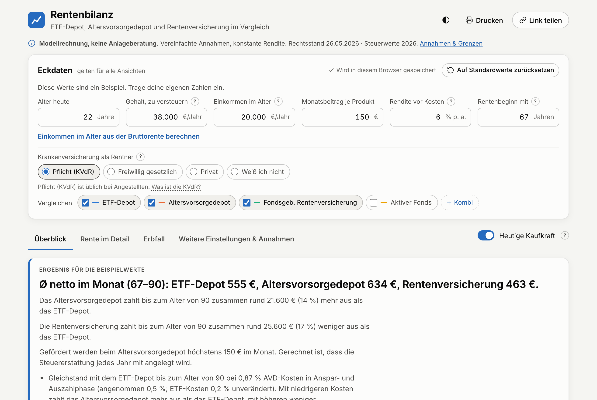

# Rentenbilanz

[Deutsch](README.md) · **English**

An open calculator for private retirement savings in Germany. Rentenbilanz compares an ETF portfolio, the new state-subsidised *Altersvorsorgedepot* (retirement savings account, from 2027), unit-linked pension insurance and an actively managed fund **after tax**. It covers taxes, subsidies, costs and health insurance across the savings and payout phases, up to inheritance.

**→ [rente.jonasseifried.com](https://rente.jonasseifried.com)** (German only)

[](LICENSE)


<picture>
  <source media="(prefers-color-scheme: dark)" srcset="docs/assets/screenshot-dark.png">
  
</picture>

> [!NOTE]
> The app, its texts and the in-depth documentation in `docs/` are in German, because the subject is German tax and social security law. This page gives an English overview of the project. The app is a model calculation without warranty, not investment, tax or legal advice.

## Features

- **Four products and combinations:** ETF portfolio, Altersvorsorgedepot, unit-linked pension insurance, active fund, plus a combination of several products that are taxed together.
- **Current German tax law:** 2026 income tax schedule (§ 32a EStG), flat-rate tax on investment income (*Abgeltungsteuer*), solidarity surcharge, church tax, joint assessment for married couples, partial exemption for equity funds and the advance lump sum (*Vorabpauschale*).
- **Subsidies:** government allowances, tax deduction and the automatic best-of check for the Altersvorsorgedepot, a spouse's contract, and salary growth until retirement.
- **Payout phase:** taxation of the payouts, health and long-term care insurance in retirement (statutory pensioner scheme KVdR, voluntary statutory or private), and a helper that turns a gross state pension into taxable income.
- **Inheritance:** what heirs receive after tax for a chosen age at death, using the heirs' own tax rate.
- **What-if:** the cost level at which a product breaks even with the ETF portfolio, hypothetical tax changes, de-risking before retirement, and results in nominal terms or today's purchasing power.
- **Transparent:** "Copy calculation" exports inputs, assumptions, model limits and yearly values as Markdown, so the numbers can be checked by hand or with an AI. Technical terms are explained in a glossary with legal references.
- **Save and share:** inputs are saved in the browser. If you already have different inputs saved, a shared link opens in a preview mode: you can look around and change values, but nothing is saved or overwritten until you click “Übernehmen” (apply). Resetting to defaults can be undone.
- **Neutral:** numbers only, no recommendation and no "winner". Factors the numbers leave out (access to the money, lock-in, cost risk) are shown separately.

## Privacy

Fully static site: no backend, no cookies, no trackers, no third-party requests. Inputs stay in the browser's `localStorage`. "Share link" stores the scenario in the URL fragment (`#`), which is never sent to the server. A strict Content Security Policy (`public/_headers`) blocks all external sources.

## Getting started

Requires Node.js 22 (see `.node-version`).

```sh
npm install
npm run dev        # http://localhost:5173
```

| Command | Purpose |
|---|---|
| `npm run build` | Static site in `dist/` |
| `npm test` | Unit and golden tests (Vitest), then performance budgets |
| `npm run test:perf` | Performance budgets only |
| `npm run test:e2e` | Browser tests (Playwright, Chromium and WebKit/iPhone, incl. axe accessibility checks) |
| `npm run test:all` | Type check, all tests, build, browser tests |

For the browser tests, run `npx playwright install chromium webkit` once.

## Deployment

Hosted on Cloudflare Pages:

- Build command: `npm run build`, output directory: `dist`
- Environment variables `IMPRESSUM_STRASSE`, `IMPRESSUM_ORT` and `IMPRESSUM_TELEFON` for the legally required imprint and privacy pages (see `.env.example`). The build fails without street and city. Locally they live in `.env.local`, which is not committed.

All paths are relative, so the site also works in a subdirectory. Name, legal status and review date are set in `src/lib/site.ts`.

## Project structure

| Path | Contents |
|---|---|
| `src/lib/engine/combo.ts` | The calculation engine. A single product is a combination with one part. |
| `src/lib/engine/law.ts` | Legal-status tables: every statutory yearly value (tax schedule, solidarity surcharge, allowances, health insurance ceiling, Altersvorsorgedepot subsidies …), one frozen table per year with sources |
| `src/lib/engine/` | Analysis (`analyze.ts`), break-even search (`breakEven.ts`), inputs (`core.ts`, `inputs.ts`). `engine.ts` is the port of the original and is kept only as a test reference. |
| `src/lib/pensionTax.ts` | Gross state pension → taxable income in retirement |
| `src/lib/rechenweg.ts` | Markdown export of the full calculation |
| `src/lib/glossary.ts`, `prosCons.ts` | Glossary and "what the numbers don't show" |
| `src/lib/link.ts`, `storage.ts`, `state.svelte.ts` | Share-link format, browser storage, app state |
| `src/lib/panels/`, `src/lib/components/` | UI (Svelte 5) |
| `legacy/index.html` | The original calculator, reference for the golden tests. Do not modify. |
| `tests/`, `e2e/` | Unit and golden tests (Vitest), browser tests (Playwright) |
| `docs/` | Calculation model, corrections with legal sources, yearly maintenance task list (German) |

## Accuracy and testing

People plan their lives with these numbers, so:

- **Golden tests:** `tests/golden.test.ts` checks the engine against the original calculator in `legacy/index.html` (29 named and 300 random scenarios). `tests/combo.test.ts` checks a one-part combination bit for bit against the reference. Both always use the 2026 values (`LAW_2026`).
- **Live fixture:** `tests/live-regression.test.ts` freezes the app's results with all corrections over about 500 cases, bit for bit (including joint assessment, church tax, combinations, tax-change scenarios). It is only regenerated deliberately, with a justified diff.
- **Corrections can be switched off:** every deviation from the first version has targeted tests and is documented with its legal source and effect in [`docs/korrekturen.md`](docs/korrekturen.md). New calculation logic goes only into `combo.ts`, so the historical reference path stays bit-identical.
- **Stable links:** default values (`DEFAULTS` in `inputs.ts`) may change. Shared links stay valid because they are encoded against a frozen baseline (`link.ts`, `LINK_VERSION`).
- **Yearly maintenance:** base interest rate, tax schedule, contribution ceilings and subsidy rules change every year. Each year gets a new legal-status table in `law.ts`, with a primary source per value; older tables stay untouched. The steps are written as a task list that can be handed to an AI agent in [`docs/jaehrliche-pflege.md`](docs/jaehrliche-pflege.md).

## Documentation (German)

- [`docs/korrekturen.md`](docs/korrekturen.md): corrections to the first version, with legal sources and effect
- [`docs/kombi-modus.md`](docs/kombi-modus.md): calculation model for product combinations
- [`docs/zulagen-veranlagung-2026-11.md`](docs/zulagen-veranlagung-2026-11.md): allowances and tax assessment for the Altersvorsorgedepot
- [`docs/kirchensteuer-splitting.md`](docs/kirchensteuer-splitting.md): church tax and joint assessment
- [`docs/gehaltsentwicklung.md`](docs/gehaltsentwicklung.md): salary growth until retirement
- [`docs/steueraenderung.md`](docs/steueraenderung.md): what-if for tax changes
- [`docs/neutrale-darstellung.md`](docs/neutrale-darstellung.md): presentation without a winner, cost break-even
- [`docs/engine-rest-2026-11.md`](docs/engine-rest-2026-11.md), [`docs/engine-review-2026-11.md`](docs/engine-review-2026-11.md): engine reviews, selectable assumptions, known limits
- [`docs/jaehrliche-pflege.md`](docs/jaehrliche-pflege.md): yearly maintenance task list, ready to hand to an AI agent

## Reporting issues

Please report calculation errors or outdated legal values as an [issue](https://github.com/JonasSeifried/rentenbilanz/issues), ideally with the shared link or the copied calculation. Issues in English are welcome. You can also email legal@jonasseifried.com.

## License

Code under the [MIT License](LICENSE). The Inter typeface is licensed under the SIL Open Font License (`src/assets/fonts/LICENSE-Inter.txt`).
