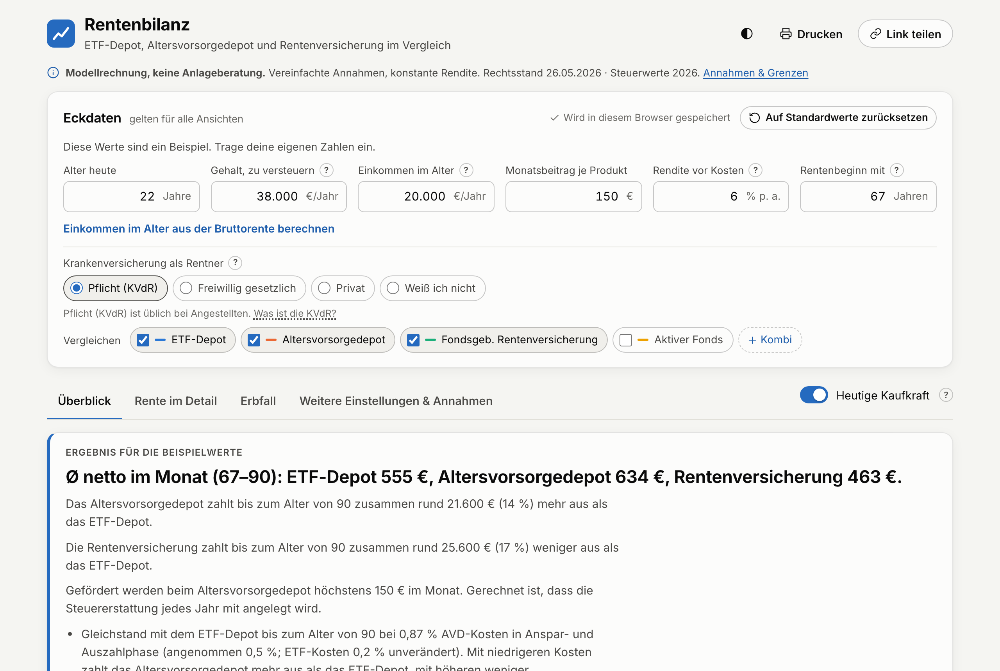

# Rentenbilanz

**Deutsch** · [English](README.en.md)

Offener Rechner für die private Altersvorsorge in Deutschland. Rentenbilanz vergleicht ETF-Depot, Altersvorsorgedepot (ab 2027), fondsgebundene Rentenversicherung und aktiven Fonds **netto**: nach Steuern, Förderung, Kosten und Krankenversicherung, über Anspar- und Auszahlphase bis zum Erbfall.

**→ [rente.jonasseifried.com](https://rente.jonasseifried.com)**

[](LICENSE)


<picture>
  <source media="(prefers-color-scheme: dark)" srcset="docs/assets/screenshot-dark.png">
  
</picture>

> [!NOTE]
> Modellrechnung ohne Gewähr. Keine Anlage-, Steuer- oder Rechtsberatung.

## Funktionen

- **Vier Produkte und Kombinationen:** ETF-Depot, Altersvorsorgedepot, fondsgebundene Rentenversicherung, aktiver Fonds; dazu eine Kombi aus mehreren Produkten mit gemeinsamer Besteuerung.
- **Steuern nach geltendem Recht:** Einkommensteuertarif 2026 (§ 32a EStG), Abgeltungsteuer, Soli, Kirchensteuer, Zusammenveranlagung, Teilfreistellung und Vorabpauschale.
- **Förderung:** Zulagen, Sonderausgabenabzug und Günstigerprüfung beim Altersvorsorgedepot, Partner-Vertrag, Gehaltsentwicklung bis zur Rente.
- **Auszahlphase:** Besteuerung der Leistungen, Kranken- und Pflegeversicherung als Rentner (KVdR, freiwillig, privat), Hilfsrechnung von der Bruttorente zum zu versteuernden Einkommen.
- **Erbfall:** was bei einem wählbaren Todesalter nach Steuern an die Erben geht, mit deren eigenem Steuersatz.
- **Was-wäre-wenn:** Kosten-Gleichstand mit dem ETF-Depot, hypothetische Steueränderungen, Umschichtung vor Rentenbeginn, Ergebnisse nominal oder in heutiger Kaufkraft.
- **Nachvollziehbar:** „Rechenweg kopieren“ gibt Eingaben, Annahmen, Modellgrenzen und Jahreswerte als Markdown aus, zum Nachrechnen von Hand oder mit einer KI. Fachbegriffe sind im Glossar mit Fundstelle erklärt.
- **Speichern und Teilen:** Eingaben bleiben im Browser gespeichert. Sind schon eigene, abweichende Eingaben gespeichert, öffnet ein geteilter Link im Ansichtsmodus und überschreibt sie erst nach „Übernehmen“. Zurücksetzen auf Standardwerte lässt sich rückgängig machen.
- **Neutral:** nur Zahlen, keine Empfehlung und kein „Sieger“. Was die Zahlen nicht zeigen (Verfügbarkeit, Bindung, Kostenrisiko), steht getrennt daneben.

## Datenschutz

Rein statische Seite: kein Backend, keine Cookies, keine Tracker, keine externen Anfragen. Eingaben bleiben im `localStorage` des Browsers. „Link teilen“ legt das Szenario in den `#`-Teil der Adresse, der nicht an den Server gesendet wird. Eine strenge Content-Security-Policy (`public/_headers`) erlaubt keine fremden Quellen.

## Schnellstart

Voraussetzung: Node.js 22 (siehe `.node-version`).

```sh
npm install
npm run dev        # http://localhost:5173
```

| Befehl | Zweck |
|---|---|
| `npm run build` | Statische Seite in `dist/` |
| `npm test` | Unit- und Golden-Tests (Vitest), danach Laufzeitbudgets |
| `npm run test:perf` | Nur die Laufzeitbudgets |
| `npm run test:e2e` | Browser-Tests (Playwright, Chromium und WebKit/iPhone, inkl. axe-Barrierefreiheit) |
| `npm run test:all` | Typprüfung, alle Tests, Build, Browser-Tests |

Für die Browser-Tests einmalig: `npx playwright install chromium webkit`.

## Deployment

Gehostet auf Cloudflare Pages:

- Build command: `npm run build`, Output: `dist`
- Umgebungsvariablen `IMPRESSUM_STRASSE`, `IMPRESSUM_ORT` und `IMPRESSUM_TELEFON` für Impressum und Datenschutz (siehe `.env.example`). Ohne Straße und Ort bricht der Build ab. Lokal stehen die Werte in `.env.local`, die nicht eingecheckt wird.

Alle Pfade sind relativ, die Seite läuft auch in einem Unterordner. Name, Rechtsstand und Prüfdatum stehen zentral in `src/lib/site.ts`.

## Projektstruktur

| Pfad | Inhalt |
|---|---|
| `src/lib/engine/combo.ts` | Die Rechen-Engine. Ein Einzelprodukt ist eine Kombi mit einem Teil. |
| `src/lib/engine/law.ts` | Rechtsstand-Tabellen: alle gesetzlichen Jahreswerte (Tarif, Soli, Pauschbeträge, KV-BBG, AVD-Förderung …), je Jahr eine eingefrorene Tabelle mit Quellen |
| `src/lib/engine/` | Auswertung (`analyze.ts`), Kosten-Gleichstand (`breakEven.ts`), Eingaben (`core.ts`, `inputs.ts`). `engine.ts` ist der Port des Originals und dient nur als Referenz. |
| `src/lib/pensionTax.ts` | Hilfsrechnung Bruttorente → zu versteuerndes Einkommen im Alter |
| `src/lib/rechenweg.ts` | Export des Rechenwegs als Markdown |
| `src/lib/glossary.ts`, `prosCons.ts` | Erklärtexte und „Was die Zahlen nicht zeigen“ |
| `src/lib/lawText.ts` | Jahreswerte als Text (`LT`) für alle Texte der Oberfläche, aus der neuesten Rechtsstand-Tabelle |
| `src/lib/link.ts`, `storage.ts`, `state.svelte.ts` | Link-Format, Speichern im Browser, App-Zustand |
| `src/lib/panels/`, `src/lib/components/` | Oberfläche (Svelte 5) |
| `legacy/index.html` | Ursprünglicher Rechner, Referenz für die Golden-Tests. Nicht ändern. |
| `tests/`, `e2e/` | Unit- und Golden-Tests (Vitest), Browser-Tests (Playwright) |
| `docs/` | Rechenmodell, Korrekturen mit Rechtsquellen, Pflege |

## Genauigkeit und Tests

Menschen planen mit diesen Zahlen. Deshalb gilt:

- **Golden-Tests:** `tests/golden.test.ts` vergleicht die Engine mit dem ursprünglichen Rechner in `legacy/index.html` (29 benannte und 300 Zufallsszenarien). `tests/combo.test.ts` prüft die Kombi mit einem Teil bitgenau gegen die Referenz. Beide rechnen immer mit den Werten von 2026 (`LAW_2026`).
- **Live-Fixture:** `tests/live-regression.test.ts` friert die Ergebnisse der App mit allen Korrekturen über rund 500 Fälle bitgenau ein (auch Splitting, Kirchensteuer, Kombi, Steueränderung). Es wird nur bewusst neu erzeugt, mit begründetem Diff. Regeltests mit Beträgen von 2026 sind fest an `LAW_2026` gebunden; `npm run test:law-probe` rechnet die Suite mit einer erfundenen neueren Tabelle und lässt nur das Live-Fixture rot werden.
- **Korrekturen sind abschaltbar:** Jede Abweichung von der ersten Fassung hat gezielte Tests und ist in [`docs/korrekturen.md`](docs/korrekturen.md) mit Rechtsquelle und Wirkung dokumentiert. Neue Rechnung kommt nur in `combo.ts`, damit der historische Referenzpfad bitgleich bleibt.
- **Stabile Links:** Standardwerte (`DEFAULTS` in `inputs.ts`) dürfen sich ändern. Geteilte Links bleiben gültig, weil sie gegen eine eingefrorene Basis kodiert sind (`link.ts`, `LINK_VERSION`).
- **Jährliche Pflege:** Basiszins, Steuertarif, Beitragsbemessungsgrenzen und Förderregeln ändern sich. Jedes Jahr kommt eine neue Rechtsstand-Tabelle in `law.ts` dazu, mit Primärquelle je Wert; alte Tabellen bleiben unverändert. Texte und Standardwerte folgen der Tabelle von selbst. Die Schritte stehen als Arbeitsauftrag (auch für eine KI) in [`docs/jaehrliche-pflege.md`](docs/jaehrliche-pflege.md).

## Dokumentation

- [`docs/korrekturen.md`](docs/korrekturen.md): Korrekturen gegenüber der ersten Fassung mit Rechtsquellen und Wirkung
- [`docs/kombi-modus.md`](docs/kombi-modus.md): Rechenmodell der Kombi
- [`docs/zulagen-veranlagung-2026-11.md`](docs/zulagen-veranlagung-2026-11.md): Zulagen und Veranlagung beim Altersvorsorgedepot
- [`docs/kirchensteuer-splitting.md`](docs/kirchensteuer-splitting.md): Kirchensteuer und Zusammenveranlagung
- [`docs/gehaltsentwicklung.md`](docs/gehaltsentwicklung.md): Gehaltsverlauf bis zur Rente
- [`docs/steueraenderung.md`](docs/steueraenderung.md): Was-wäre-wenn bei Steueränderungen
- [`docs/neutrale-darstellung.md`](docs/neutrale-darstellung.md): Darstellung ohne Sieger, Kosten-Gleichstand
- [`docs/engine-rest-2026-11.md`](docs/engine-rest-2026-11.md), [`docs/engine-review-2026-11.md`](docs/engine-review-2026-11.md): Engine-Reviews, wählbare Annahmen, offene Grenzen
- [`docs/jaehrliche-pflege.md`](docs/jaehrliche-pflege.md): Arbeitsauftrag für die jährlich wechselnden Werte, direkt an eine KI übergebbar

## Fehler melden

Fehler in der Rechnung oder veraltete Rechtsstände bitte als [Issue](https://github.com/JonasSeifried/rentenbilanz/issues) melden, möglichst mit dem geteilten Link oder dem kopierten Rechenweg. Alternativ per E-Mail an legal@jonasseifried.com.

## Lizenz

Code unter [MIT](LICENSE). Die Schrift Inter steht unter der SIL Open Font License (`src/assets/fonts/LICENSE-Inter.txt`).
